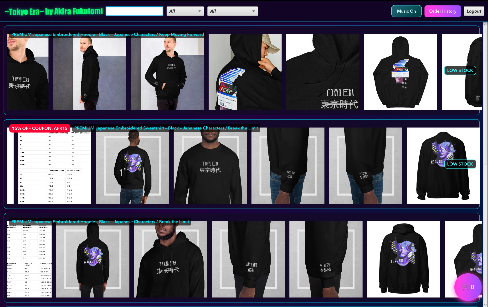
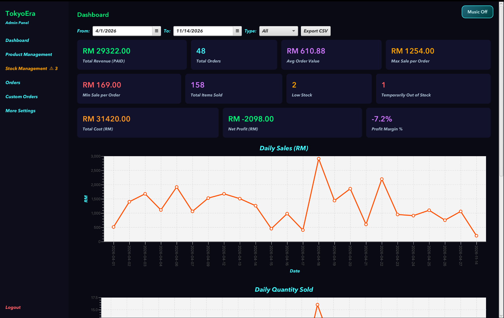
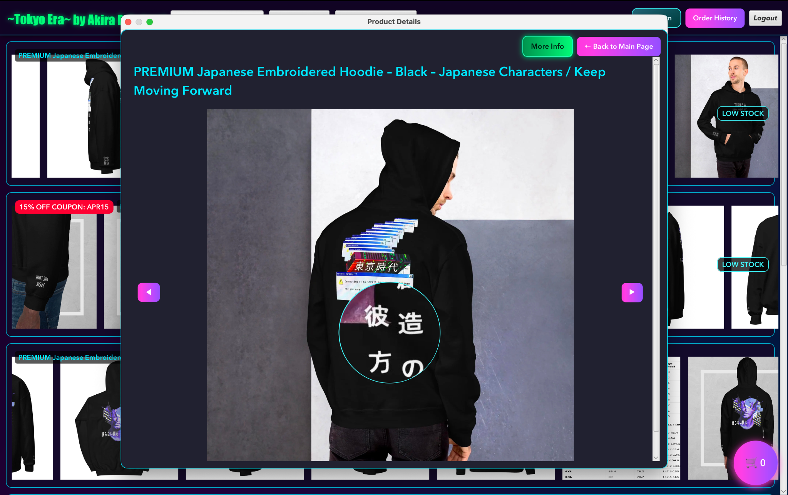
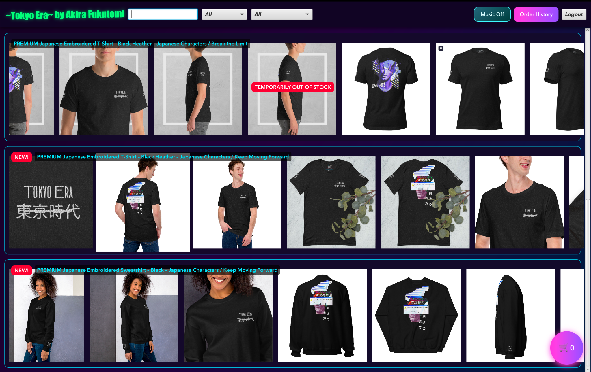
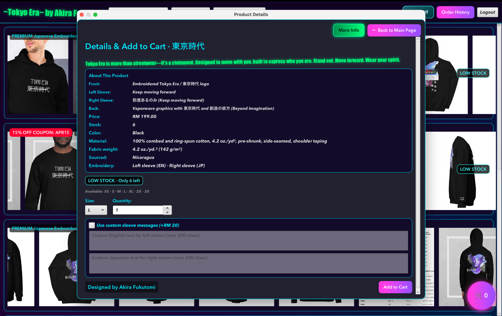

# TokyoEra Management System

**A JavaFX retail management application built with Java 21, SQLite, and Maven.**

TokyoEra brings together a customer-facing clothing storefront and an administrative management dashboard in one desktop application. It supports product discovery, shopping carts, checkout, order tracking, inventory management, promotions, and sales reporting.

> **Project type:** Coursework / desktop application  
> **Tech stack:** Java 21 · JavaFX · SQLite · Maven · JUnit

## Overview

The system provides two role-based experiences:

| Customer storefront | Admin dashboard |
| --- | --- |
| Browse, search, filter, and sort products | Create, edit, and remove products |
| Choose sizes, quantities, and optional custom sleeve text | Monitor stock and low-stock items |
| Manage a persistent shopping cart and apply coupons | Manage orders and custom orders |
| Check out, view order history, and export PDF receipts | Analyze revenue, costs, profits, and sales trends |

## Application screenshots

The JavaFX interface includes a customer-facing storefront and a separate admin workspace. The screenshots below show the application with demonstration product and sales data.

### Customer storefront and admin dashboard

<table>
  <tr>
    <td width="50%" align="center"><strong>Customer storefront</strong></td>
    <td width="50%" align="center"><strong>Admin sales dashboard</strong></td>
  </tr>
  <tr>
    <td></td>
    <td></td>
  </tr>
</table>

<details>
<summary><strong>View more customer screens — product gallery, catalog, and customization</strong></summary>

#### Product image gallery



#### Product catalog and stock indicators



#### Product information and customization



</details>

## Features

### Customer experience

- **Account access:** Login, registration, and role-based routing.
- **Product discovery:** Search, clothing-type filters, sorting, and product detail dialogs.
- **Product customization:** Select size and quantity, with optional custom sleeve text.
- **Persistent cart:** Add, update, and remove items; cart state is saved to SQLite and restored on login.
- **Checkout and orders:** Complete checkout, review past orders, and export PDF receipts.
- **Promotions:** Apply supported coupon codes during checkout.

### Administration

- **Product management:** Create, read, update, and delete products.
- **Inventory oversight:** Review stock levels and configure low-stock thresholds.
- **Order management:** Review regular and custom orders, filter records, and update statuses.
- **Sales analytics:** View revenue, costs, net profit, profit margin, daily trends, and category breakdowns.
- **Reports and exports:** Filter by date and category, visualize sales, and export CSV reports.
- **Storefront configuration:** Manage product badges and coupon settings, including percentage discounts and product-specific applicability.

### Reliability and validation

- SQLite persistence for users, products, orders, order items, transactions, and settings.
- Login lockout after **5 failed attempts** for **5 minutes**.
- Input validation and error handling across authentication, cart, checkout, inventory, and admin operations.
- JUnit tests for models, services, validation, integrations, and reporting.
- Seeded demo accounts for exploring the application.

## Getting started

### Requirements

- **JDK 21** — the version used to develop the project. Newer JDKs, including Java 25, may work but are not guaranteed to be compatible with the project's JavaFX/Maven configuration.
- macOS, Linux, or Windows.
- Internet access on the first build to download Maven dependencies.

The repository includes the **Maven Wrapper**, so a separate Maven installation is not required.

### macOS / Linux

From the project root:

```bash
chmod +x mvnw
./mvnw clean test
./mvnw javafx:run
```

### Windows (PowerShell or Command Prompt)

From the project root:

```powershell
.\mvnw.cmd clean test
.\mvnw.cmd javafx:run
```

**Note:** Run these commands from the project root so the application can locate its database and media assets. If startup fails on Java 25, try JDK 21 and check the JavaFX/Maven error output.

## Demo accounts

| Role | Username | Password |
| --- | --- | --- |
| Administrator | `admin` | `Admin@123!` |
| Customer | `user` | `User@123!` |
| Seeded demo customers | `demo_user_01` through `demo_user_20` | `Demo@123!` |

> These are **demonstration credentials**, not passwords suitable for a deployed application. Change or remove default credentials before any real-world deployment.

## Exploring the application

**Customer workflow:** Sign in as `user`, browse and filter clothing products, open a product's details, select options, add items to the cart, apply a coupon if available, then check out. After checkout, review your order history or export the PDF receipt.

**Admin workflow:** Sign in as `admin` to review dashboard statistics, manage products and stock, inspect orders and custom orders, generate filtered reports, export CSV data, and configure storefront or coupon settings.

## Project structure

```text
Retail-Management-System/
├── code/
│   ├── main/
│   │   └── App.java          # Application entry point: tokyoera.App
│   └── test/                 # JUnit tests
├── pics/
│   ├── products/             # Clothing images (product1/–product5/)
│   ├── videos/               # Background video assets (Matrix1–5.mp4)
│   └── music/                # Background music
├── Media/                     # README screenshots
│   ├── customer_storefront.png
│   ├── admin_dashboard.png
│   ├── product_gallery.png
│   ├── customer_catalog.png
│   └── product_customization.png
├── tokyoera.db               # SQLite database
├── pom.xml                   # Maven / JavaFX configuration
├── mvnw                       # Maven Wrapper (macOS/Linux)
├── mvnw.cmd                   # Maven Wrapper (Windows)
└── target/                    # Generated build output (after building)
```

`target/` is compiled output rather than application source code and is normally regenerated during the build.

## Technical design

### Application and persistence

TokyoEra is a JavaFX desktop application with role-based customer and administrator interfaces. SQLite stores users, products, orders, order items, transactions, and application settings. This keeps shopping and management data available between sessions.

### Retail operations

The cart is restored from SQLite when a customer signs in and saved when they sign out. Product and order operations are connected to inventory, discount, and reporting workflows, with validation for inputs and stock-related actions.

### Reporting and profitability

The administration dashboard includes sales summaries, category breakdowns, daily trends, and report filters. Profit-related figures distinguish revenue, product costs, and net profit. The project's original-cost reference values are:

| Clothing type | Original product cost |
| --- | ---: |
| Hoodie | RM 230 |
| Sweatshirt | RM 200 |
| T-shirt | RM 160 |

*Shipping is excluded from these reference costs.*

### Testing

Run the JUnit test suite with:

```bash
./mvnw clean test
```

Tests cover business logic, models, validation, integration flows, and report generation.

## Creative assets

- **Clothing designs:** Created by Akira Fukutomi using Printful and Etsy.
- **Music/audio:** Created by Akira Fukutomi using FL Studio.
- **Visual assets:** Product images, background videos, and music are stored under `pics/`.

Any third-party platform resources remain subject to their respective licenses and terms.

## Project scope

TokyoEra was developed as **coursework** to demonstrate end-to-end desktop application development: user interfaces, authentication, persistent data, transaction workflows, inventory management, business reporting, and automated testing.

It is a demonstration system rather than a production-ready payment or commerce platform. The seeded accounts and example pricing are provided for testing and exploration.
